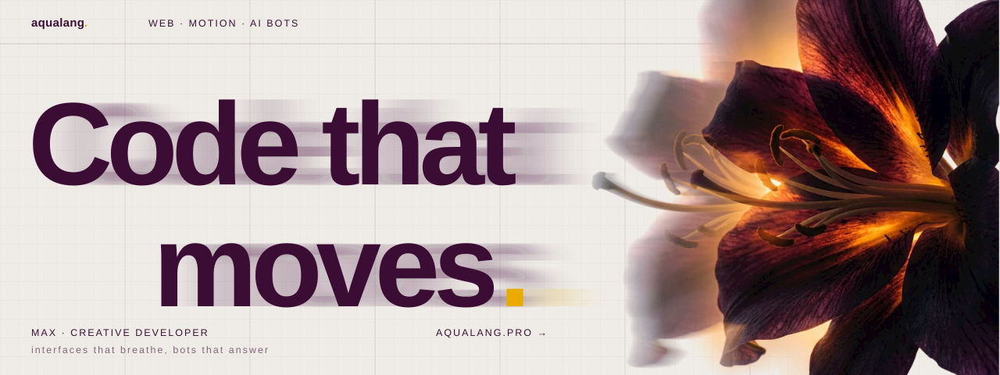

Hi, I'm Max. I build interfaces that move and bots that answer: web components with real physics, motion for products, and Telegram bots with an LLM inside.

Most of what I make for fun ends up in **[shipnotes-components](https://github.com/aqualang89/shipnotes-components)**: free, MIT, one file each, live demos.

<table>
  <tr>
    <td width="33%"> <b>ASCII Ghost</b> a ghost made of your page's own text</td>
    <td width="33%"> <b>Iris</b> a light orb that listens, thinks and speaks</td>
    <td width="33%"> <b>Card File</b> a shelf of projects in six worlds</td>
  </tr>
  <tr>
    <td width="33%"> <b>Secret Garden</b> type, and a winter garden grows</td>
    <td width="33%"> <b>AI Face Flow</b> 180,000 particles that become a face</td>
    <td width="33%"> <b>Dust Orb</b> light inside a cloud of dust</td>
  </tr>
</table>

**Work with me:** [aqualang.pro](https://aqualang.pro) · new components first on [Instagram @shipnotesai](https://www.instagram.com/shipnotesai/)
